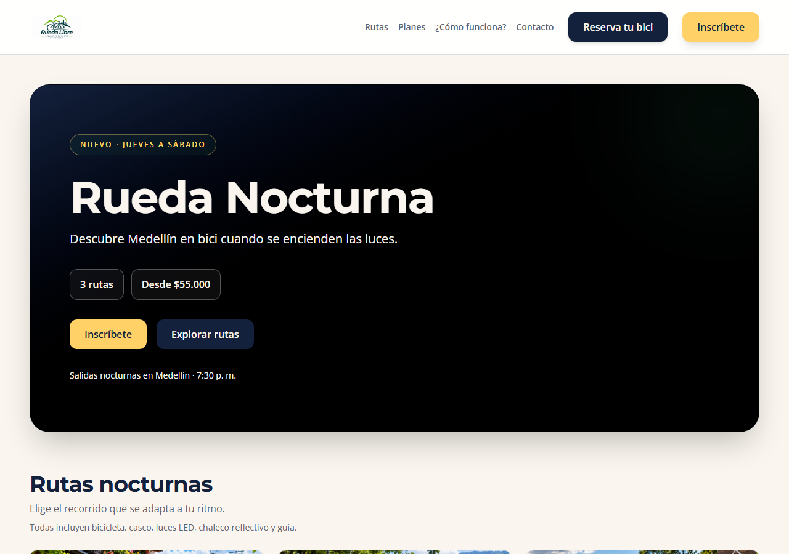
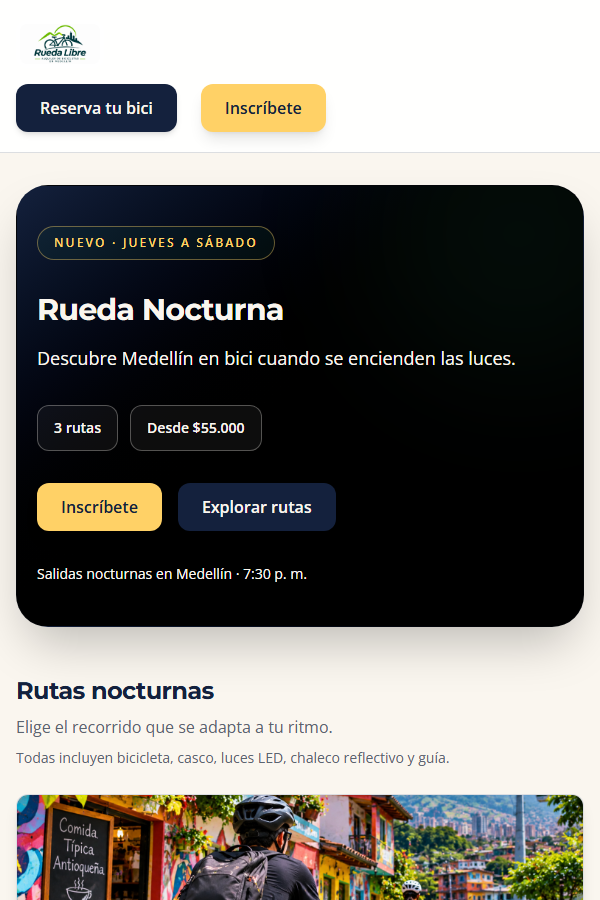
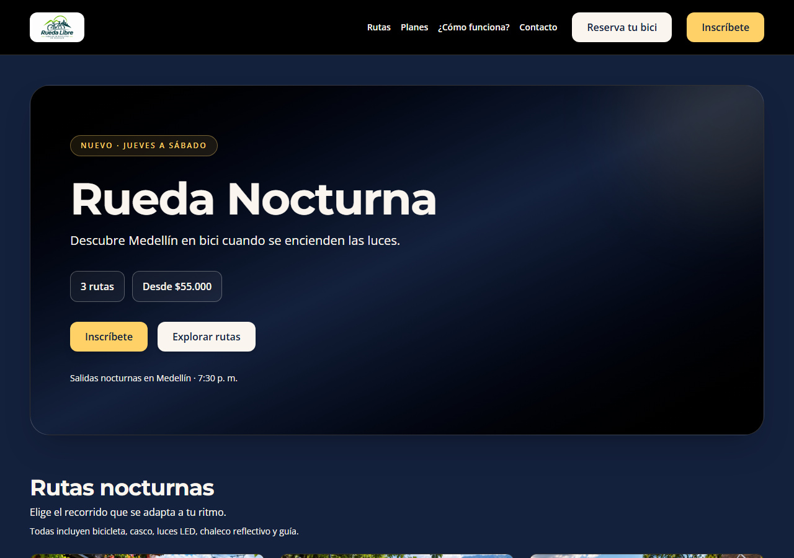

# Rueda Libre

Sitio web para una empresa de alquiler de bicicletas y recorridos guiados en Medellín. El proyecto conserva el sitio principal con Bootstrap y agrega la campaña Rueda Nocturna con Tailwind CSS.

## Sitio publicado

- [Inicio](https://andresa01.github.io/Actividades_Riwi/rueda-libre/)
- [Tarifas y rutas](https://andresa01.github.io/Actividades_Riwi/rueda-libre/paginas/tarifas.html)
- [Reservas](https://andresa01.github.io/Actividades_Riwi/rueda-libre/paginas/reservas.html)
- [Rueda Nocturna](https://andresa01.github.io/Actividades_Riwi/rueda-libre/nocturna/index.html)
- [Kit de componentes](https://andresa01.github.io/Actividades_Riwi/rueda-libre/nocturna/componentes.html)
- [Prototipo](https://andresa01.github.io/Actividades_Riwi/rueda-libre/nocturna/prototipo.html)

Las páginas publicadas responden correctamente. Los cambios del Día 3 de la Semana 3 quedarán visibles en GitHub Pages después del push final.

## Páginas del proyecto

- `index.html`: inicio, promociones, servicios, rutas y flota.
- `paginas/tarifas.html`: tarifas de bicicletas y recorridos.
- `paginas/reservas.html`: formulario de alquiler y horarios.
- `nocturna/index.html`: landing de Rueda Nocturna, planes e inscripción.
- `nocturna/componentes.html`: botones, alertas, campos y card de referencia.
- `nocturna/prototipo.html`: propuesta inicial del hero.
- `bitacora.txt`: desarrollo y validaciones detalladas por minireto.

## Tecnologías

- HTML5 semántico y CSS3.
- Bootstrap 5.3.9 y Bootstrap Icons 1.13.2 para el sitio existente.
- Tailwind CSS 4.3.5 CLI para la landing; `nocturna/src/output.css` es la hoja generada y minificada.
- JavaScript nativo para la validación local del formulario.
- Montserrat y Open Sans.
- GitHub Pages para la publicación estática.

La inscripción aplica validación en el navegador. La página es una demostración estática: no envía ni almacena información en un servidor.

## Capturas

Escritorio, tema claro:

Vista móvil a 600 px (menú de secciones oculto y contenido en una columna):

Escritorio, tema oscuro:

## Recomendación técnica

Usar Tailwind CSS para nuevas páginas de campaña que necesiten una identidad visual propia y conservar Bootstrap en el sitio actual. La comparación de aprendizaje, personalización, tamaño y casos de uso está en `bitacora.txt`; los productos medidos tienen alcances distintos, así que sus tamaños no son un benchmark directo.

## Guion de demo (3 minutos)

| Tiempo | Recorrido |
| --- | --- |
| 0:00–0:30 | Presentar Rueda Libre y el objetivo de la campaña nocturna. |
| 0:30–1:00 | Navegar desde el sitio Bootstrap a Rueda Nocturna y volver a Reservas. |
| 1:00–1:40 | Mostrar las tres rutas, los planes y el plan Pareja destacado. |
| 1:40–2:20 | Probar el formulario vacío, un celular inválido y una inscripción válida de prueba; explicar que no se transmiten datos. |
| 2:20–2:45 | Mostrar la vista móvil y el tema oscuro. |
| 2:45–3:00 | Resumir las decisiones técnicas y abrir preguntas. |

Decisiones para explicar: compilar Tailwind y reutilizar tres clases de botón; mantener la validación nativa del formulario sin fingir un backend.

## Aprendizajes

- La semántica y las etiquetas asociadas hacen que un formulario se entienda y se recorra con teclado.
- Los breakpoints mobile-first permiten adaptar navegación, rutas, planes y formulario a distintos anchos.
- El modo oscuro requiere comprobar el contraste de cada superficie; los textos del hero deben seguir claros porque su fondo siempre es oscuro.
- Tailwind genera una hoja estática minificada para producción y facilita reunir colores y fuentes de marca en `@theme`.

## Autor

[@andresa01](https://github.com/andresa01)
